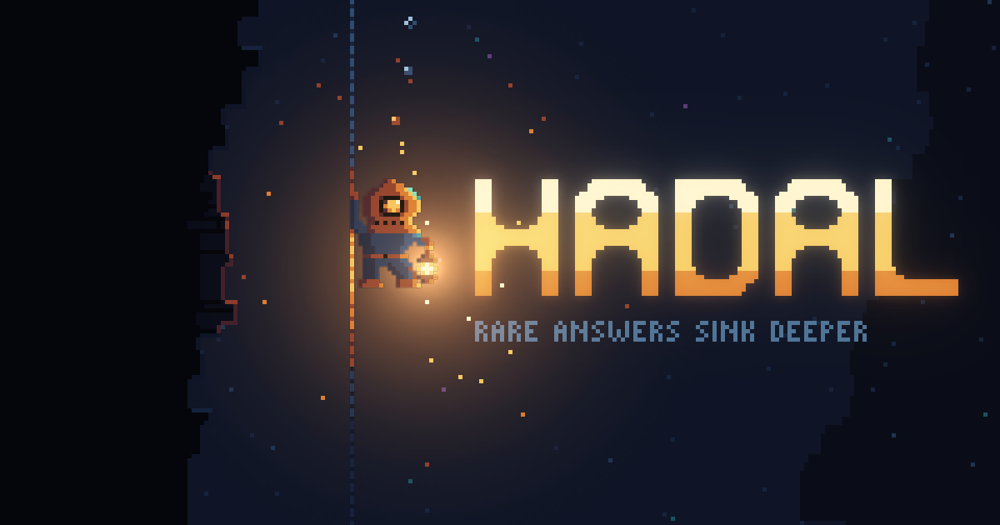

# Hadal

*Hadal* refers to the deepest region of the ocean, it is a web game where you score more with rarer answers. You play as a diver placing lanterns deep down into the sea, in this journey, you might encounter whales, fishes, and... wait, what is that thing staring at me?

You can play Hadal for free at [hadal.seria.moe](https://hadal.seria.moe).

## Features

- Original visual style made from scratch.
- Custom packs support, and create packs using LLMs.
- Real-time answer judgement using jev.
- More game modes.